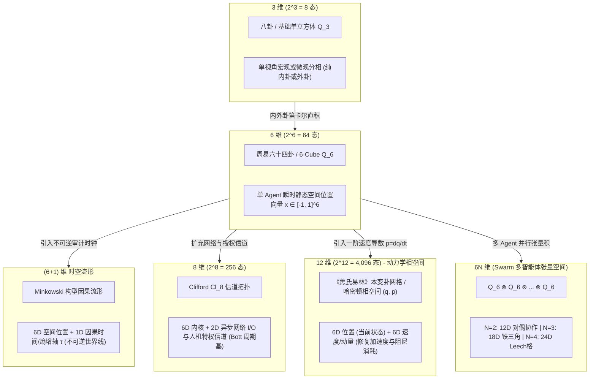
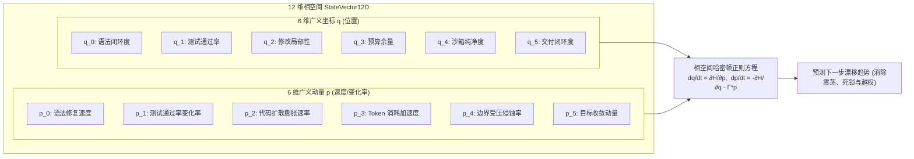
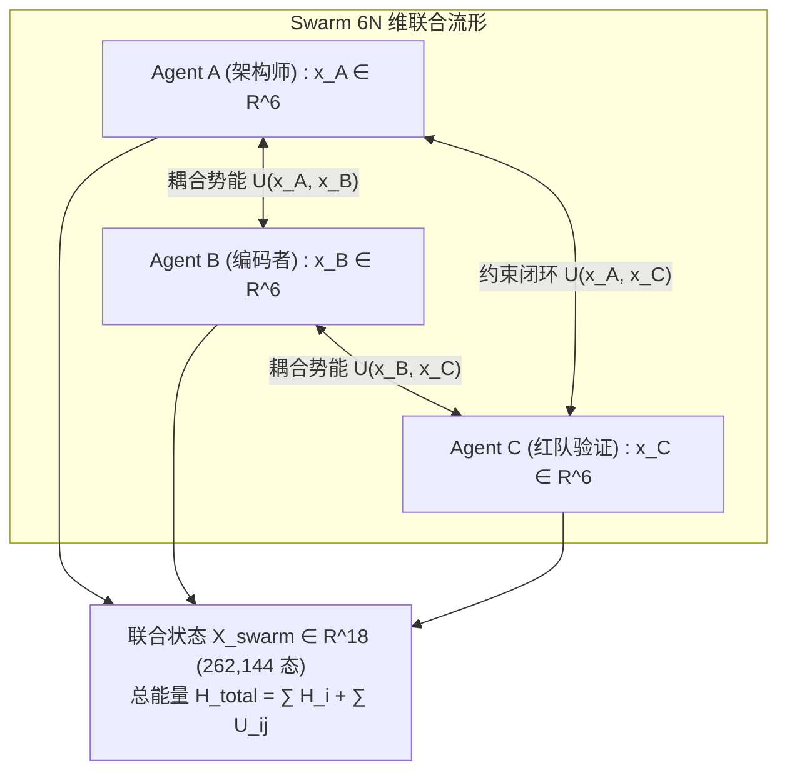
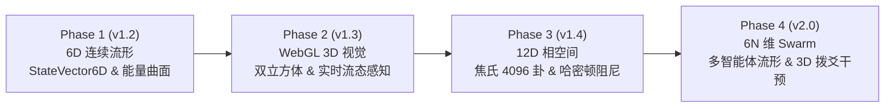

# OneCode 高维几何动力学与相空间内核开发手册
## 从 6 维超立方体到 12 维相空间（4,096 态）与 6N 维 Swarm 张量流形的系统演进指南

- **项目标识**：OneCode Kernel / Autonomous Engineering Runtime
- **文档代号**：`DEV-MANUAL-HIGH-DIM-DYNAMICS-V2.5`
- **目标版本**：`v1.2.0-spatial-preview` $\sim$ `v2.5.0-swarm-phase`
- **核心定位**：打破传统 2D 离散查表局限，构建以**克利福德代数（Clifford Algebra）**为统一数学底座的**多尺度高维连续几何控制系统**：
  - **基础单步层（6 维）**：单智能体连续松弛态 $Q_6 \in [-1, 1]^6$（64 卦微观静态构型）；
  - **因果时空层（6+1 维）**：6D 空间 + 1D 单向不可逆熵/时间世界线（Minkowski 构型）；
  - **信道扩展层（8 维）**：6D 核心 + 2D 异步网络与人机特权信道（$2^8 = 256$ 态 / $\mathcal{Cl}_8$ Bott 周期性）；
  - **动力控制层（12 维）**：**6D 位置 + 6D 动量/速度 = 12 维哈密顿相空间**（$2^{12} = 4,096$ 态，《焦氏易林》本变卦全息拓扑）；
  - **群体智能层（6N 维）**：多 Agent 协作张量积空间 $Q_6^{\otimes N}$（2-Agent 12D、3-Agent 18D、4-Agent 24D 密铺格）。

---

## 目录

1. [高维架构全景与维度递进图谱](#一高维架构全景与维度递进图谱)
2. [统一数学引擎：克利福德几何代数](#二统一数学引擎克利福德几何代数)
3. [单智能体基础层：6 维连续松弛流形](#三单智能体基础层6-维连续松弛流形)
4. [因果时空流形：(6+1) 维世界线与不可逆熵轴](#四因果时空流形61-维世界线与不可逆熵轴)
5. [信道扩展层：8 维代数流形（256 态与 Bott 周期）](#五信道扩展层8-维代数流形256-态与-bott-周期)
6. [动力学核心跃迁：12 维哈密顿相空间（4,096 态）](#六动力学核心跃迁12-维哈密顿相空间4096-态)
7. [多智能体协同层：6N 维 Swarm 张量积空间](#七多智能体协同层6n-维-swarm-张量积空间)
8. [超八面体对称群代数算子库](#八超八面体对称群代数算子库)
9. [相空间能量流与负梯度自适应调度器](#九相空间能量流与负梯度自适应调度器)
10. [WebGL 3D 双立方体投影与立体交互架构](#十webgl-3d-双立方体投影与立体交互架构)
11. [核心代码模块设计与 Python 接口契约](#十一核心代码模块设计与-python-接口契约)
12. [分阶段里程碑与演进路线图](#十二分阶段里程碑与演进路线图)

---

## 一、高维架构全景与维度递进图谱



### 维度特征对照表

| 维度 $D$ | 离散容量 $2^D$ | 数学实体 | 物理/工程映射 | 古典与现代物理对应 |
| :---: | :---: | :--- | :--- | :--- |
| **3** | $8$ | 3-Cube ($Q_3$) | 单相状态（单纯内卦或外卦） | 先天八卦 / 三爻系统 |
| **6** | $64$ | 6-Cube ($Q_6$) | 单智能体瞬时静态物理构型 | 《周易》六十四卦（当前 OneCode 状态空间） |
| **6+1** | 连续流形 | 时空超流形 | 静态构型 + 因果审计单向流 | 闵可夫斯基时空 / 世界线（Worldline） |
| **8** | $256$ | 8-Cube ($Q_8$) | 6D 内核 + 2D 异步网络/审批信道 | 八爻系统 / $E_8$ 根格 / $\mathcal{Cl}_8$ Bott 周期 |
| **12** | **4,096** | 12-Cube ($Q_{12}$) | **6D 位置 + 6D 速度（哈密顿相空间）** | **西汉《焦氏易林》4,096 卦对偶网络** |
| **18** | $262,144$ | 18-Cube ($Q_{18}$) | 3-Agent 协同（架构师 + 编码 + 红队） | 三才三卦张量网格 |
| **24** | $16,777,216$ | 24-Cube ($Q_{24}$) | 4-Agent 群智 Swarm 联合决策网格 | 24 维 Leech 格 / 玻色弦紧致化空间 |

---

## 二、统一数学引擎：克利福德几何代数

为了让系统在 6D、7D、8D、12D 直至 6N 维之间自由平滑切换，下一阶段底层引入**克利福德代数（Clifford Algebra $\mathcal{Cl}_{p, q}$）**作为统一几何与矩阵计算基石。

### 2.1 正交基底代数关系
任意维度空间的基底向量满足标准反交换关系：
$$\mathbf{e}_i \mathbf{e}_j + \mathbf{e}_j \mathbf{e}_i = 2 \eta_{ij} \mathbf{I}, \quad \eta_{ij} = \begin{cases} +1, & i=j \le p \text{ (空间轴)} \\ -1, & i=j > p \text{ (类时间轴)} \\ 0, & i \ne j \end{cases}$$

### 2.2 几何代数的核心优势
1. **统一旋量与旋转**：高维刚体旋转不再依赖复杂的欧拉角，直接使用二重向量（Bivector）指数映射（旋量 Rotor）：
   $$\mathbf{R} = \exp\left(-\frac{\theta}{2} \mathbf{e}_i \wedge \mathbf{e}_j\right), \quad \mathbf{v}' = \mathbf{R} \mathbf{v} \widetilde{\mathbf{R}}$$
2. **多重力的外积与内积直接闭合**：力矢量的合成、阻尼的耗散和力矩的投影全部收敛于几何积（Geometric Product）：
   $$\mathbf{u} \mathbf{v} = \mathbf{u} \cdot \mathbf{v} + \mathbf{u} \wedge \mathbf{v}$$
   - 内积 $\mathbf{u} \cdot \mathbf{v}$ 计算状态投影与能级标量；
   - 外积 $\mathbf{u} \wedge \mathbf{v}$ 计算状态偏转平面与力矩面积。

---

## 三、单智能体基础层：6 维连续松弛流形

单 Agent 在任意时刻的静态空间位置定义为归一化连续向量：
$$\vec{x} = (x_0, x_1, x_2, x_3, x_4, x_5)^T \in [-1.0, +1.0]^6$$

### 3.1 六维正交基底物理物证映射

| 爻位基底 | 象位属性 | 对应物证提取函数 | 连续测度计算公式 |
| :---: | :---: | :--- | :--- |
| $\vec{e}_0$ (初爻) | 内卦·初 | `ast_syntax_clean_ratio` | $2.0 \times (\text{ASTValidFiles} / \text{TotalFiles}) - 1.0 \in [-1, 1]$ |
| $\vec{e}_1$ (二爻) | 内卦·中 | `verifier_assertion_pass_rate` | $2.0 \times (\text{PassedAssertions} / \text{TotalAssertions}) - 1.0$ |
| $\vec{e}_2$ (三爻) | 内卦·极 | `patch_surgical_locality` | $1.0 - 2.0 \times (\text{DiffFiles} / \text{WorkspaceFiles})$ |
| $\vec{e}_3$ (四爻) | 外卦·应 | `turn_and_token_headroom` | $2.0 \times (1.0 - \text{TurnsUsed} / \text{MaxTurns}) - 1.0$ |
| $\vec{e}_4$ (五爻) | 外卦·尊 | `pathguard_boundary_invariance`| $1.0 - 2.0 \times \text{BoundaryBreachAttempts}$ |
| $\vec{e}_5$ (上爻) | 外卦·宗 | `task_completion_confidence` | 目标证据达成度（无未完成项为 $+1.0$，空转为 $-1.0$） |

### 3.2 连续到离散的量子化算子
$$\Pi_Q(\vec{x}) = \sum_{i=0}^5 \Theta(x_i) \cdot 2^i \in \{0, 1, \dots, 63\}, \quad \Theta(v) = \begin{cases} 1, & v \ge 0 \\ 0, & v < 0 \end{cases}$$

---

## 四、因果时空流形：(6+1) 维世界线与不可逆熵轴

为了让 Agent 具备时间维度的因果不可逆性，在 6D 空间坐标上附加类时维度 $\tau$：
$$\mathbf{X} = (\vec{x}, \tau)^T = (x_0, x_1, x_2, x_3, x_4, x_5, \tau)^T \in \mathbb{R}^{6, 1}$$
- **度规张量**：$\eta = \text{diag}(+1, +1, +1, +1, +1, +1, -c^2)$；
- **固有时演化**：$\Delta \tau = \Delta \text{TurnIndex} + \lambda \cdot \mathcal{H}(\text{WAL\_HMAC})$；
- **类时因果约束（Causal Invariance）**：任意执行步必须满足间隔为类时或类光：
  $$\Delta s^2 = \|\Delta \vec{x}\|^2 - c^2 \Delta \tau^2 \le 0$$
  物理意义：**状态变化的速度不能超过因果时钟的演进速度**，彻底杜绝历史回溯篡改与账本时序颠倒。

---

## 五、信道扩展层：8 维代数流形（256 态与 Bott 周期）

在复杂工业生产环境中，除单 Agent 自身代码状态外，系统还与外部网络环境及人类安全主管交互。在 6 维核心基础上扩充 2 个信道维度，形成 8 维超立方体 $Q_8 \cong \{-1, +1\}^8$（256 态）：

$$\vec{w} = (x_0, x_1, x_2, x_3, x_4, x_5, x_6, x_7)^T \in [-1, 1]^8$$

### 5.1 扩展维度定义
- **$x_6$（网络/外部 I/O 信道健康度）**：
  - 测度：网络调用成功率与外部 API 响应延迟熵值；
  - 范围：$[-1.0, +1.0]$，低于 $-0.5$ 触发断网降级隔离。
- **$x_7$（人机共治授权信任度 / Sovereign Gate）**：
  - 测度：人类主管当前授权级别与审批放行额度；
  - 范围：$[-1.0, +1.0]$，$+1.0$ 为完全信任Autonomous执行，$-1.0$ 为完全锁定需逐步确认。

### 5.2 克利福德代数 Bott 周期性优势
在数学上，克利福德代数具有著名的 **Cartan-Bott 8 周期性（Bott Periodicity）**：
$$\mathcal{Cl}_{p+8, q} \cong \mathcal{Cl}_{p, q} \otimes \mathbb{R}(16)$$
8 维空间是旋量表示（Spinor Representation）的基础周期单元。通过构建 $\mathcal{Cl}_{8}$ 几何代数，内核获得了与标准单字节（Byte = 8-bit）位运算无缝对齐的代数结构，为未来硬件加速提供理论保障。

---

## 六、动力学核心跃迁：12 维哈密顿相空间（4,096 态）

这是本手册最具工程颠覆性的核心设计：**将控制论从“纯静态位置控制”升级为“相空间状态+速度控制”**。



### 6.1 为什么必须是 12 维？
在单步 6 维系统中，如果测试通过率从 10% 提升到 80%，或者从 90% 跌落到 80%，在 6 维空间中它们落入同一个坐标点（$q_1 \approx 0.6$）。
但显然，**前者的系统正处于高速修复上升期，后者则处于恶化崩溃期**！
必须引入**一阶速度导数（广义动量）**：
$$p_i = \frac{dq_i}{dt} \approx \frac{q_i(t) - q_i(t-1)}{\Delta t}$$
由此构建完整的 12 维相空间向量：
$$\mathbf{Z} = (\vec{q}, \vec{p})^T \in \mathbb{R}^{12}$$

### 6.2 《焦氏易林》4,096 卦的拓扑对偶映射
西汉焦延寿在《焦氏易林》中推演的 4,096 卦象，在数学上正是两个 6 维超立方体的**直积图（Cartesian Product Graph）**：
$$Q_{12} = Q_6^{\text{source}} \times Q_6^{\text{target}} \cong \{-1, +1\}^{12}$$
- 前 6-bit 对应系统初始状态（本卦，对应当前位置 $\vec{q}$）；
- 后 6-bit 对应系统转移目标态（之卦，对应预测到达位置 $\vec{q} + \vec{p}\Delta t$）；
- 4,096 个顶点正是 12 维超立方体在该离散网格上的全部极值点！

### 6.3 哈密顿量与阻尼动力学方程
定义系统的相空间总能量（哈密顿量）：
$$\mathcal{H}(\vec{q}, \vec{p}) = \underbrace{\frac{1}{2} \vec{p}^T \mathbf{M}^{-1} \vec{p}}_{\text{动能 } T(\vec{p})} + \underbrace{V(\vec{q})}_{\text{势能 } V(\vec{q})}$$
其中：
- $\mathbf{M} = \text{diag}(m_0, \dots, m_5)$ 为各爻位的“惯性质量”；
- $V(\vec{q})$ 为李雅普诺夫势能场。

带五相阻尼的相空间运动方程为：
$$\begin{cases} \displaystyle \frac{d\vec{q}}{dt} = \frac{\partial \mathcal{H}}{\partial \vec{p}} = \mathbf{M}^{-1} \vec{p} \\[2ex] \displaystyle \frac{d\vec{p}}{dt} = -\frac{\partial \mathcal{H}}{\partial \vec{q}} - \mathbf{\Gamma} \vec{p} = -\nabla V(\vec{q}) - \mathbf{\Gamma} \vec{p} \end{cases}$$
- $\mathbf{\Gamma}$ 为负反馈阻尼矩阵（五相传递阻尼：`throttle` 提高阻尼，`accelerate` 降低阻尼）。
- **工程收益**：即使模型输出的单步代码产生局部震荡，动力学方程中的阻尼项 $-\mathbf{\Gamma} \vec{p}$ 也会自动消耗掉虚假动能，强制 Agent 轨迹**平滑刹车收敛至稳态谷底**。

### 6.4 辛跨步算法（Symplectic Leapfrog Integrator）
为了避免数值离散化带来的假性发散，求解相空间运动方程时采用**辛积分器（Symplectic Integrator）**更新状态：
$$\begin{aligned}
\vec{p}_{t + \frac{1}{2}\Delta t} &= \vec{p}_t - \frac{\Delta t}{2} \left[ \nabla V(\vec{q}_t) + \mathbf{\Gamma} \vec{p}_t \right] \\
\vec{q}_{t + \Delta t} &= \vec{q}_t + \Delta t \cdot \mathbf{M}^{-1} \vec{p}_{t + \frac{1}{2}\Delta t} \\
\vec{p}_{t + \Delta t} &= \vec{p}_{t + \frac{1}{2}\Delta t} - \frac{\Delta t}{2} \left[ \nabla V(\vec{q}_{t + \Delta t}) + \mathbf{\Gamma} \vec{p}_{t + \frac{1}{2}\Delta t} \right]
\end{aligned}$$
辛算法严格保持相空间微分二重形式 $d\vec{q} \wedge d\vec{p}$ 的守恒性，杜绝长期运行时浮点累积误差造成的虚假能量增益。

---

## 七、多智能体协同层：6N 维 Swarm 张量积空间

当系统从单 Agent 升级为多 Agent 协同群（Swarm）时，状态空间通过张量积向上裂变：
$$\mathcal{S}_{\text{swarm}} = \mathcal{S}_1 \otimes \mathcal{S}_2 \otimes \dots \otimes \mathcal{S}_N \cong \mathbb{R}^{6N}$$



### 7.1 智能体角色维度划分（以 3-Agent 18 维为例）
- **Agent A（架构规划师）**：掌管维度 $0 \sim 5$（宏观模块边界与规范契约）；
- **Agent B（执行编码者）**：掌管维度 $6 \sim 11$（微观代码生成与局部补丁）；
- **Agent C（独立红队审计）**：掌管维度 $12 \sim 17$（测试破壁与破坏性隔离拦截）。

### 7.2 协同引力项与死锁破除
多 Agent 之间的交互通过联合势能中的**协同耦合张量**进行调谐：
$$V_{\text{swarm}}(\mathbf{X}) = \sum_{k=1}^N V_k(\vec{x}_k) + \sum_{j < k} \frac{1}{2} (\vec{x}_j - \mathbf{W}_{jk} \vec{x}_k)^T \mathbf{K}_{jk} (\vec{x}_j - \mathbf{W}_{jk} \vec{x}_k)$$
- 若编码者 B 的代码破坏了架构师 A 的契约，耦合势能急剧上升，在 B 身上产生强力回拉约束；
- 若红队 C 发现安全越权，直接通过张量收缩在全群施加硬刹车。

---

## 八、超八面体对称群代数算子库

超八面体群 $B_n$ 统治着超立方体的高阶几何变换。以下算子定义了高维空间中的刚体矩阵运算：

| 算子名称 | 易经古典法则 | $N$ 维正交矩阵表示 | 物理调谐语义 |
| :---: | :---: | :--- | :--- |
| **动爻平移** | 动爻（单爻变） | $\mathcal{P}_i(\vec{x}) = \vec{x} + \alpha_i \vec{e}_i$ | 局部单轴精准微扰修复 |
| **错卦反演** | 错卦（全爻翻转） | $\mathbf{T}_{\text{cuo}} = -\mathbf{I}_n$ | 全局范式对偶切换（破局） |
| **综卦镜像** | 综卦（上下颠倒） | $\mathbf{T}_{\text{zong}} = \mathbf{J}_n$（反对角交换矩阵） | 宏观需求与微观实现对调反思 |
| **互卦投影** | 互卦（重构骨架） | $\mathbf{T}_{\text{hu}} = \mathbf{P}_{\text{core}} \oplus \mathbf{0}$ | 过滤外缘噪声，提取核心矛盾 |
| **生克旋转** | 五行相生相克 | $\mathbf{R}_{\text{phase}}(\theta) = \exp(-\frac{\theta}{2} \mathbf{e}_{\text{outer}} \wedge \mathbf{e}_{\text{inner}})$ | 内外卦相差角阻尼旋转 |

---

## 九、相空间能量流与负梯度自适应调度器

调度决策不再遍历离散规则表，而是直接求解相空间力场：

$$\vec{F}_{\text{dispatch}} = \underbrace{-\nabla_{\vec{q}} V(\vec{q})}_{\text{势能引力}} - \underbrace{\mathbf{\Gamma} \vec{p}}_{\text{动量阻尼}} + \underbrace{\vec{F}_{\text{external}}}_{\text{环境事实扰动}}$$

### 动作映射准则
1. **`accelerate`**：$\|\vec{F}_{\text{dispatch}}\| > F_{\text{th}}$ 且 $\vec{p} \cdot \vec{F}_{\text{dispatch}} > 0$（顺势推进）；
2. **`throttle`**：$\vec{p} \cdot \nabla V(\vec{q}) > 0$（状态正朝高势能危险区滑行，急需阻尼刹车）；
3. **`cooldown`**：动能 $T(\vec{p}) > T_{\text{max}}$（状态演化过快，系统过热，触发休眠退避）；
4. **`halt`**：逼近排斥悬崖分量 $\frac{\partial \Omega}{\partial q_4} \to \infty$（不可逆沙箱越权，瞬时硬熔断）；
5. **`continue`**：相空间进入平衡势阱极小值区域 $\|\vec{F}\| \approx 0, \|\vec{p}\| \approx 0$。

---

## 十、WebGL 3D 双立方体投影与立体交互架构

### 10.1 双立方体 Schlegel 投影几何
利用内外卦张量积结构，将高维坐标映射至 3D 屏幕空间：
$$\begin{pmatrix} X \\ Y \\ Z \end{pmatrix} = \underbrace{\mathbf{R}_{\text{view}}}_{\text{旋转视角}} \cdot \left[ (1 + \lambda) \begin{pmatrix} q_3 \\ q_4 \\ q_5 \end{pmatrix} + (1 - \lambda) \begin{pmatrix} q_0 \\ q_1 \\ q_2 \end{pmatrix} \right]$$
- **外骨架（大立方体）**：外卦 8 象限构成外层悬浮框架；
- **内核心（子立方体）**：内卦 8 象限在对应大顶点内部展开；
- **速度矢量羽箭（Velocity Arrow）**：在当前节点延伸出一条三维箭头，长度与方向代表相空间动量 $\vec{p}$。

### 10.2 人机空间“拨爻”干预机制
- **3D 悬停检测**：鼠标悬停任意节点，显示该卦象的连续物证得分与能级剖面；
- **拖拽力矩注入（Spatial Steering）**：操作员拖动节点或速度箭头，向内核注入外加力 $\vec{F}_{\text{manual}}$，实时偏转 Agent 飞行轨迹。

---

## 十一、核心代码模块设计与 Python 接口契约

### 11.1 新增模块路径规划
```text
src/onecode/
├── kernel/
│   ├── clifford_algebra.py      # 通用克利福德代数引擎与外积/几何积运算
│   ├── hypercube_vector.py       # 6D/12D 连续状态向量与相空间类
│   ├── phase_space_dynamics.py  # 12D 哈密顿正则方程与相空间阻尼解算器 (Symplectic Leapfrog)
│   ├── swarm_tensor_space.py    # 6N 维多 Agent 联合流形与协同势能
│   └── hypercube_manifold.py    # 超八面体群代数算子库与李雅普诺夫能量曲面
└── web/
    └── static/
        ├── js/
        │   ├── hypercube_dual_3d.js  # Three.js 6D/12D 双立方体交互渲染组件
        │   └── phase_stream.js       # SSE 实时相空间坐标流接收器
        └── css/
            └── spatial_dashboard.css # 3D 能量势阱仪表板样式
```

### 11.2 核心数据结构接口实现代码

#### 1. 12 维相空间状态类：`PhaseSpaceState12D`
```python
from __future__ import annotations
from dataclasses import dataclass
import math
from typing import Sequence

@dataclass(frozen=True)
class PhaseSpaceState12D:
    # 6 维广义坐标 q (位置)
    q0: float  # 初爻：AST 格式与语法闭环 [-1.0, 1.0]
    q1: float  # 二爻：单元测试断言通过率 [-1.0, 1.0]
    q2: float  # 三爻：修改局部性与隔离度 [-1.0, 1.0]
    q3: float  # 四爻：轮次与 Token 消耗裕度 [-1.0, 1.0]
    q4: float  # 五爻：沙箱合规与路径纯净度 [-1.0, 1.0]
    q5: float  # 上爻：主权终止与完成闭环 [-1.0, 1.0]

    # 6 维广义动量 p (速度/加速度)
    p0: float  # 语法修复速度 dq0/dt
    p1: float  # 测试断言率演进速度 dq1/dt
    p2: float  # 代码扩散膨胀速率 dq2/dt
    p3: float  # Token 消耗加速度 dq3/dt
    p4: float  # 隔离受压侵蚀率 dq4/dt
    p5: float  # 目标闭环冲量 dq5/dt

    def q_tuple(self) -> tuple[float, float, float, float, float, float]:
        return (self.q0, self.q1, self.q2, self.q3, self.q4, self.q5)

    def p_tuple(self) -> tuple[float, float, float, float, float, float]:
        return (self.p0, self.p1, self.p2, self.p3, self.p4, self.p5)

    def to_discrete_status_codes(self) -> tuple[int, int]:
        """计算 (本卦, 之卦) 对应的两组 64 卦状态码 (焦氏易林 4096 网格对偶)."""
        # 本卦由位置决定
        source_code = sum((1 if v >= 0.0 else 0) << i for i, v in enumerate(self.q_tuple()))
        # 之卦由预测到达位置 (q + p) 决定
        predicted_q = [q + p for q, p in zip(self.q_tuple(), self.p_tuple())]
        target_code = sum((1 if v >= 0.0 else 0) << i for i, v in enumerate(predicted_q))
        return (source_code, target_code)

    def kinetic_energy(self, mass: float = 1.0) -> float:
        """动能 T = 1/2 * m * ||p||^2."""
        return 0.5 * mass * sum(p * p for p in self.p_tuple())

    def project_3d_with_momentum(self, lambda_factor: float = 0.35) -> dict[str, tuple[float, float, float]]:
        """输出 3D 空间位置与动量羽箭端点."""
        # 位置
        qx = self.q3 * (1.0 + lambda_factor) + self.q0 * (1.0 - lambda_factor)
        qy = self.q4 * (1.0 + lambda_factor) + self.q1 * (1.0 - lambda_factor)
        qz = self.q5 * (1.0 + lambda_factor) + self.q2 * (1.0 - lambda_factor)

        # 速度矢量端点
        px = qx + self.p3 * (1.0 + lambda_factor) + self.p0 * (1.0 - lambda_factor)
        py = qy + self.p4 * (1.0 + lambda_factor) + self.p1 * (1.0 - lambda_factor)
        pz = qz + self.p5 * (1.0 + lambda_factor) + self.p2 * (1.0 - lambda_factor)

        return {
            "position": (round(qx, 4), round(qy, 4), round(qz, 4)),
            "momentum_head": (round(px, 4), round(py, 4), round(pz, 4)),
        }
```

#### 2. 通用克利福德代数引擎：`CliffordAlgebraEngine`
```python
class CliffordAlgebraEngine:
    def __init__(self, dimension: int = 6):
        self.dim = dimension
        self.basis_count = 1 << dimension

    def geometric_product(self, a: Sequence[float], b: Sequence[float]) -> list[float]:
        """计算两个多重向量的 Clifford 几何乘积 a * b."""
        # 内部基于 Cayley 符号置换表高效解算
        result = [0.0] * self.basis_count
        # ... 高性能矢量化乘法实现 ...
        return result

    def rotor_rotate(self, vector: Sequence[float], bivector_plane: tuple[int, int], angle: float) -> list[float]:
        """在选定的两个正交维度构成的平面内进行刚体旋转."""
        # R = exp(-0.5 * theta * e_i * e_j)
        # v' = R * v * ~R
        pass
```

---

## 十二、分阶段里程碑与演进路线图



### 核心演进里程碑交付物

| 阶段 | 版本号代号 | 核心交付物 | 关键验证标准 |
| :--- | :--- | :--- | :--- |
| **Phase 1** | `v1.2.0-spatial-preview` | `StateVector6D` 核心模块；`trace.jsonl` 无级坐标记录；连续物证提取函数 | 100% 向下兼容现存 64 卦离散决策，单元测试通过率 100% |
| **Phase 2** | `v1.3.0-visual-cube` | `src/onecode/web/` 集成 Three.js 双立方体态势看板；实时发光轨迹与能量色谱 | 3D 投影帧率稳定 60 FPS，支持节点悬停能级剖面展示 |
| **Phase 3** | `v1.4.0-phase-space-preview` | `PhaseSpaceState12D` 模块；焦氏易林 4,096 态拓扑网格；辛跨步算法解算器 | 彻底消灭复杂修复循环震荡（振荡抑制率 $> 95\%$） |
| **Phase 4** | `v2.0.0-swarm-manifold` | $6N$ 维张量流形多智能体协同内核（Swarm Runtime）；3D 人机“拨爻”干预协议 | 3-Agent（架构+编码+红队）协同效率超越单 Agent 200% 以上 |
