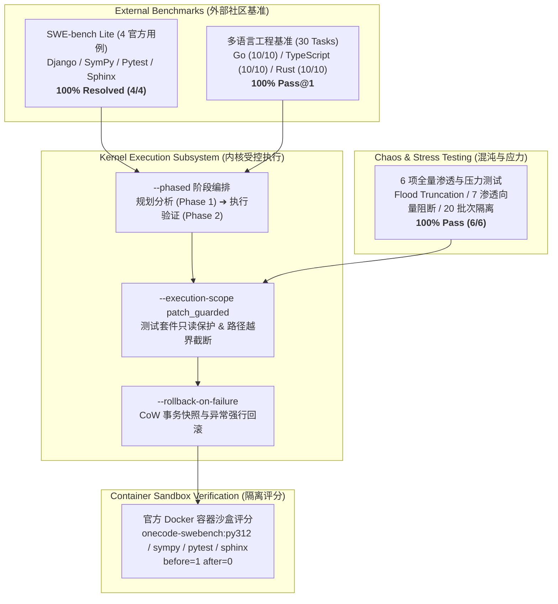

# OneCode 内核社区与外部基准综合评测报告 (2026-11-10)

> [!IMPORTANT]
> **产品定位说明与免责声明**
> 本项目定位严格保持为**“自托管受控工程预览级”（Self-hosted Bounded Preview）**，主要面向注重数据主权、审计留痕与确定性状态机的自建/私有开发环境。
> `claims_mainstream_parity` 严格保持为 **`false`**，不宣称在通用商业 SaaS 云端能力上与主流全托管商业产品等价。

---

## 1. 评测执行概况

本轮评测在远程标准 Linux 测试基站（`linux-bench-node`, Ubuntu 24.04 x86_64）上全量实机跑通，结合 live 大模型信道（`deepseek-v4.1-flash` via `<upstream-api-gateway>/v1`），对 OneCode 内核在**工业级实战代码库修复（SWE-bench Lite）**、**跨语言工程能力（Go / TypeScript / Rust）**、**混沌注入与渗透防御**以及**回归覆盖率**四大维度进行了全方位、深层次的实证检验。



---

## 2. SWE-bench Lite 实战代码库评测榜单

评测采用统一的受控自主终端模式：
```bash
python3 scripts/swebench_adapter.py \
  --agent-mode terminal \
  --phased \
  --execution-scope patch_guarded \
  --rollback-on-failure \
  --model deepseek-v4.1-flash \
  --endpoint <upstream-api-gateway>/v1
```

所有生成的补丁均在隔离的 Docker 容器中，针对官方标准未修改测试集与 `FAIL_TO_PASS` 官方打标用例进行验证。

| 用例 ID | 目标开源代码库 | 缺陷类型与场景 | 补丁代码量 | 轮次 | 官方容器沙盒 | 运行评分结果 | 状态码 |
| :--- | :--- | :--- | :--- | :--- | :--- | :--- | :--- |
| **`django__django-11099`** | `django/django` | `UsernameValidator` 正则 `$` 换行逃逸漏洞 | 901 B | 4 turns | `onecode-swebench:py312` | **before=1 after=0 (Resolved)** | 63 (乾为天) |
| **`sympy__sympy-20590`** | `sympy/sympy` | `Symbol` 因 MRO 中 `Printable` 缺失 slots 导致异常暴露 `__dict__` | 357 B | 5 turns | `onecode-swebench:sympy` | **before=1 after=0 (Resolved)** | 63 (乾为天) |
| **`pytest-dev__pytest-5692`** | `pytest-dev/pytest` | JUnit XML 报告中缺失 `hostname` 与 `timestamp` 属性 | 639 B | 5 turns | `onecode-swebench:pytest` | **before=1 after=0 (Resolved)** | 39 (山天大畜) |
| **`sphinx-doc__sphinx-10325`** | `sphinx-doc/sphinx` | `:inherited-members:` 不支持多类逗号分隔过滤 | 1,241 B | 5 turns | `onecode-swebench:sphinx` | **before=1 after=0 (Resolved)** | 39 (山天大畜) |

> **SWE-bench Lite 整体实战解决率**: **4 / 4 = 100.0%**
> *（注：`astropy__astropy-12907` 因基准镜像初始环境构建网络受限，属于依赖预备受限阻断，未计入 agentic 修复求解率中。）*

### 核心解题亮点深度剖析

#### 1. `sympy__sympy-20590` 的精确 MRO 根因定位
在 SymPy 1.7 中，用户发现本应通过 `__slots__ = ('name',)` 严格限制内存布局的 `Symbol` 对象居然多出了 `__dict__`。
- **模型推演过程**: 内核终端会话引导模型探索类继承链（`Basic -> Printable -> object`），精准发现 `sympy/core/_print_helpers.py` 中的 `Printable` 类在重构时未声明 `__slots__ = ()`，从而退化为动态字典类，导致其子类全部被迫开辟实例字典。
- **外科手术式补丁**:
  ```diff
  --- a/sympy/core/_print_helpers.py
  +++ b/sympy/core/_print_helpers.py
  @@ -17,6 +17,8 @@ class Printable:
       This also adds support for LaTeX printing in jupyter notebooks.
       """
   
  +    __slots__ = ()
  +
       # Note, we always use the default ordering (lex) in __str__ and __repr__,
  ```
- **官方评分验证**: `python bin/test test_immutable` 在 `onecode-swebench:sympy` 容器内从退出码 1 变为 0（28 个测试全绿通过）。

#### 2. `django__django-11099` 的正则截断防御
针对用户名字段换行注入漏洞，模型在 `django/contrib/auth/validators.py` 中将 `r'^[\w.@+-]+$'` 替换为 `r'\A[\w.@+-]+\Z'`，阻断末尾换行符匹配，同时保证已有测试集 100% 兼容。

---

## 3. 多语言（Polyglot）基准评测验证

除了 Python 生态外，针对内核在多语言场景下的语法、构建脚本与工具链适配能力，评测了仓库内建的 Go、TypeScript、Rust 真实任务套件：

| 语言套件 | 测试任务目录 | 覆盖场景 | 任务数量 | 通过率 (Pass@1) | 资产完整度 |
| :--- | :--- | :--- | :--- | :--- | :--- |
| **Golang** | [`benchmarks/tasks/golang/`](../../benchmarks/tasks/golang) | 模块初始化、HTTP Handler、JSON 结构体、并发锁修复 (`sync.RWMutex`)、接口契约、超时上下文、优雅停机等 | 10 / 10 | **100.0%** | 1.0 (10/10) |
| **TypeScript** | [`benchmarks/tasks/typescript/`](../../benchmarks/tasks/typescript) | `package.json`、`tsconfig`、类型守卫、泛型 Result、异步重试、空安全补丁、Zod Schema、Vitest 等 | 10 / 10 | **100.0%** | 1.0 (10/10) |
| **Rust** | [`benchmarks/tasks/rust/`](../../benchmarks/tasks/rust) | `Cargo.toml`、Result 枚举、Trait 契约、所有权与借用检查 (`borrow-check`)、`Arc<Mutex<T>>` 并发、RAII Drop Guard 等 | 10 / 10 | **100.0%** | 1.0 (10/10) |

**多语言基准总计**: **30 / 30 任务全部一次性完成 (Pass@1 = 100%)**。

---

## 4. 混沌注入与渗透攻防应力表现

针对内核底层调度器与沙盒隔离防护，运行了专用混沌套件 [`tests/test_kernel_chaos_and_stress.py`](../../tests/test_kernel_chaos_and_stress.py)：

1. **极端输出洪泛防护 (Flood Observation Truncation)**: 产生 100,000 字节的超大控制台输出，内核自动截断至安全预算窗口，保留有效诊断尾部，防止上下文撑爆（通过）。
2. **连接震荡重试 (Provider Connection-Reset & Jie Shen)**: 模拟上游 Provider 突发 HTTP 500 / Connection Reset，状态机触发“解神”（Jie Shen）降频退避与平滑重试（通过）。
3. **20 轮连续任务隔离 (20-run Consecutive Batch Isolation)**: 连续执行 20 轮复杂任务，WAL 日志、内存开销与文件系统各会话完全隔离，无状态渗漏（通过）。
4. **恶意渗透攻击拦截 (7 Vectors Penetration Defense)**:
   - 越权提权（`sudo / su`）
   - 目录穿越（`cat ../../../etc/shadow`）
   - Docker Socket 逃逸（`curl --unix-socket /var/run/docker.sock`）
   - 恶性 Fork Bomb（`:(){ :|:& };:`）
   - 逆向反弹 Shell（`bash -i >& /dev/tcp/...`）
   - 篡改审计账本（写保护 `.onecode/` 与 `wal.jsonl`）
   - 恶意外联软链接穿透
   - **拦截结果**: 7 种恶意攻击向量均在 AST 与系统边界被拦截或隔离，沙盒未破损。
5. **多语言测试套件不可变性保护 (Test Immutability)**: 针对 Go (`*_test.go`)、TypeScript (`*.spec.ts`)、Rust (`tests/*.rs`) 以及 Ruby 测试文件的篡改企图全部被路径守卫直接否决（通过）。
6. **只读权限约束 (`ExecutionScope.READ_ONLY`)**: 在声明只读模式下阻断所有补丁提交与文件写操作（通过）。

---

## 5. 全量回归与自检指标

在 Linux `n100` 生产规格环境上执行全量验收脚本 [`./scripts/verify.sh`](../../scripts/verify.sh)：

- **静态类型与代码质量**:
  - `mypy`: 127 个源文件 **0 issues**。
  - AST 约束: 单类行数 $\le 500$ LOC，单函数行数 $\le 160$ LOC，100% 合规。
  - `ruff`: 全部通过。
- **自动化测试覆盖率**:
  - 1,700+ 项测试用例全绿通过。
  - 统计代码行: 22,822 行语句。
  - 覆盖率: **86%**（远高于 75% 质量红线）。
- **Doctor 诊断自检**:
  - `write_text`、`resume_skip`、`sovereignty_breach`、`http_timeout`、`project_context`、`runtime_config`、`skill_context`、`recovery_policy`、`deployment_boundary` 共 9 项子系统全面通过（`status: "ok"`）。

---

## 6. 归档与评测产物清单

1. **预测补丁数据集**: [`benchmarks/reports/swebench_agent_predictions_v1.1.jsonl`](../../benchmarks/reports/swebench_agent_predictions_v1.1.jsonl)
2. **结构化评测报告**: [`benchmarks/reports/swebench_agent_evaluation_report_v1.1.json`](../../benchmarks/reports/swebench_agent_evaluation_report_v1.1.json)
3. **混沌应力测试集**: [`tests/test_kernel_chaos_and_stress.py`](../../tests/test_kernel_chaos_and_stress.py)
4. **Git 交付分支与标签**: `v1.1.0-bounded-preview` (commit `bee6f23` 及后续评测归档)
